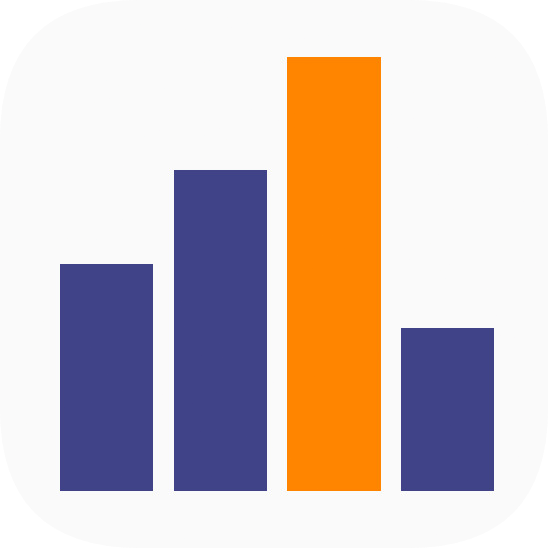

<p align="center"></p>

# PlotTwist

**Explore data together, in the browser.**

PlotTwist lets several people explore related CSV tables at the same time. Brush a region in any plot and the matching rows light up in every other plot, on your screen and on everyone else's.

https://github.com/user-attachments/assets/99ff9bad-c4c1-4bcd-af79-6230571ec2b0

Also on [YouTube](https://www.youtube.com/watch?v=4oBw2toIiUc).

## Running it

You need the .NET 8 SDK, Node.js and npm (tested with .NET SDK 8.0.126, Node 18.19.1, npm 9.2.0).

Backend (`backend/`):

```sh
cd backend
dotnet restore   # first time only
dotnet run
```

Frontend (`frontend/`), in another terminal:

```sh
cd frontend
npm install      # first time only
npm run dev
```

Then open http://localhost:5173/. Open it in a second tab or browser to see the collaboration.

## Adding plots

Plots are plugins: one `.js` file in `frontend/js/plots/` that you register in the `plots` array in `frontend/js/main.js`. See [frontend/js/plots/README.md](frontend/js/plots/README.md) for the API.

